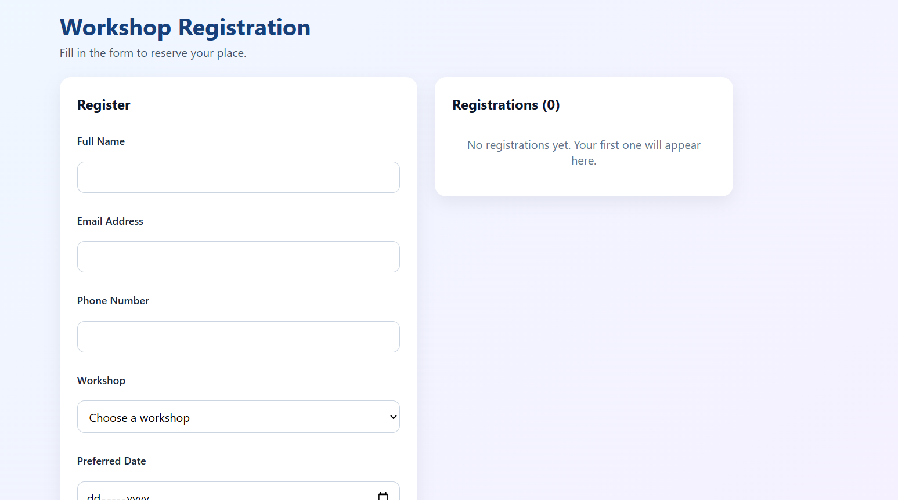
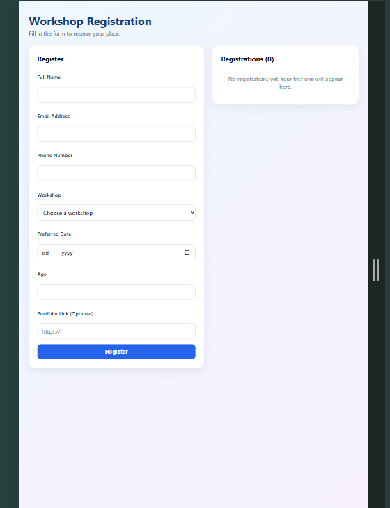

# Interactive Workshop Registration

A responsive React form (built with Vite) for registering for workshops, with validation and a live registration list.

## Setup instructions

1. Install Node.js and VS Code.
2. Download or clone this repository.
3. Open the project folder in VS Code.
4. Run `npm install` in the terminal.
5. Run `npm run dev` and open the local address shown in the terminal (usually http://localhost:5173).

## Features

- Every field is controlled by React state (text, email, tel, select, date, number, url)
- Validation with a specific error message beside each field
- Invalid submissions are blocked
- Valid registrations are added with the spread operator and appear immediately
- The form clears and shows a success message after registering
- Registrations are removed with `filter()` without mutating state
- Accessible labels, `aria-invalid` and `role="alert"` errors, responsive layout
- Extension feature: duplicate email check, so the same email cannot register twice

## Screenshots

Desktop view:

Phone view:

